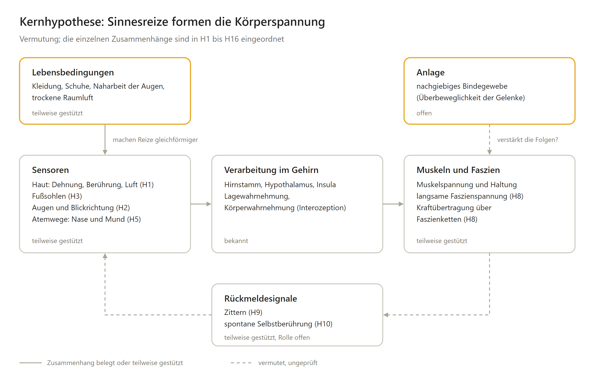
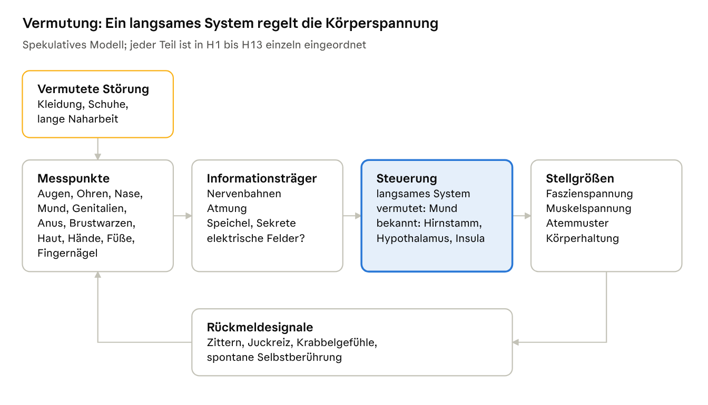

# Körperspannung und Sinnesreize: Beobachtungen und prüfbare Hypothesen

Stand: 18. November 2026

## Kurzfassung

Aus jahrelangen eigenen Beschwerden und genauer Selbstbeobachtung ist eine Vermutung entstanden: Reize an Haut, Füßen und Atemwegen formen laufend die Spannung von Muskeln und Faszien. Moderne Lebensbedingungen wie Kleidung, Schuhe und trockene Raumluft machen diese Reize gleichförmiger. Das könnte die Regulation der Körperspannung verschlechtern, besonders bei Menschen mit nachgiebigem Bindegewebe.

Dieses Dokument stellt die Vermutung und die Beobachtungen dahinter zur Prüfung bereit. Es ist in drei Teile gegliedert:

- **Teil A:** Hypothesen, für die es Belege gibt und die sich gut prüfen lassen
- **Teil B:** einzelne Beobachtungen, die erst ein Blindtest bestätigen oder widerlegen kann
- **Teil C:** Ideen, die ich geprüft und verworfen habe, mit Begründung

Ich möchte wissen, was davon Einbildung ist und was eine Untersuchung wert sein könnte.

### English summary

This document collects observations and testable hypotheses on body tension and sensory input, written by a lay person on the basis of long self-observation. Each hypothesis is checked against published research and rated as known, partly supported, open, unsupported or refuted.

**Core hypothesis:** Sensory input from the skin, the soles of the feet and the airways continuously shapes the tension of muscles and fascia. Modern living conditions such as near-constant clothing, shoes, near work and dry indoor air make this input more uniform. This may impair the regulation of body tension, especially in people with lax connective tissue (joint hypermobility), who may rely more on cutaneous and plantar signals for stability.

The document is organised in three parts: hypotheses with partial support (Part A), single observations that need a blinded test (Part B), and ideas that were checked and discarded, with reasons (Part C). Each hypothesis (H1 to H16) includes a proposed test. Feedback, especially disagreement with sources, is very welcome.

## Zweck und Status dieses Dokuments

Dies ist eine Sammlung von Beobachtungen und Hypothesen, keine Behauptung und keine Lehre. Ich schreibe als Betroffener, nicht als medizinische Fachperson.

- **Was es ist:** eine geordnete Sammlung meiner Beobachtungen und Vermutungen, jeweils mit dem Forschungsstand, den ich finden konnte.
- **Was es nicht ist:** keine Diagnose, keine Therapieempfehlung und kein Ersatz für ärztliche Abklärung.
- **Was ich mir wünsche:** dass Fachleute einzelne Hypothesen prüfen. Ist sie widerlegt, schon bekannt oder eine Untersuchung wert?
- **Warum ich es aufschreibe:** Ich kann selbst nicht sicher unterscheiden, ob ich einen normalen Mechanismus des Körpers wahrnehme oder ob meine Beschwerden die Empfindungen erzeugen. Diese Frage sollen andere mit unabhängigen Methoden klären (siehe „Einbildung, Krankheit oder Fund?“).

Widerspruch ist ausdrücklich erwünscht. Eine widerlegte Hypothese ist für mich ein brauchbares Ergebnis.

## Hintergrund

Ich habe seit Jahren starke Verspannungen und weitere Beschwerden. Auf der Suche nach Ursachen habe ich begonnen, meinen Körper genau zu beobachten. Daraus sind die Vermutungen in diesem Dokument entstanden.

In meiner Vorgeschichte gibt es Faktoren, die Körperwahrnehmung, Muskelspannung und Bewegungen nachweislich beeinflussen können: Besonderheiten von Nervensystem und Bindegewebe sowie Medikamente und Substanzen. Die Einzelheiten sind bewusst nicht Teil dieses Dokuments. Es geht um die Beobachtungen, nicht um meinen Fall. Fachleuten, die eine Beobachtung ernsthaft prüfen wollen, teile ich sie auf Anfrage mit.

Meine eigenen Beobachtungen können die Hypothesen deshalb nicht belegen. Sie sind ein Ausgangspunkt. Tragen müssen die Hypothesen Tests, die unabhängig von meinem Fall funktionieren.

**Laufender Selbstversuch:** Luftfeuchte (H15) und Kleidung (H1) prüfe ich in einem 14-wöchigen Versuch mit vorab festgelegten Kriterien, siehe [`beobachtungen/versuchsplan.md`](beobachtungen/versuchsplan.md).

**Beobachtungsprotokoll** (zum Ausfüllen; je genauer, desto besser prüfbar):

| Beobachtung | In welcher Situation? | Wie oft, wie stark? | Seit wann? | Zugehörige Hypothese |
| --- | --- | --- | --- | --- |
| Beschwerden bei niedriger Luftfeuchte deutlich stärker |  |  |  | H15 |
| Zu Hause (Fußbodenheizung, Laminat) spannen und bewegen sich Muskeln unwillkürlich |  |  |  | H15 |
| Häufiges Gelenkknacken |  |  |  | H1, H15 |
| Zittern wird stärker, je weniger der Körper im Gleichgewicht ist |  |  |  | H9 |
| Krabbelgefühle oder Juckreiz treten scheinbar gezielt an bestimmten Stellen auf |  |  |  | H10 |
| Reize an bestimmten Stellen von Kopf und Zähnen lösen Reaktionen an festen Stellen im Körper aus (Zahn-Körper-Karte) | Zeit der stärksten Verspannung | Zuordnung jedes Mal gleich |  | H7 |
| Zähneknirschen oder Spannung im Mund in der Nacht |  |  |  | H7 |
| Finger wenige Zentimeter über der Haut wirken anders als Berührung, besonders an den Füßen |  |  |  | H16 |
| Streichen auf und ab wirkt anders als links und rechts |  |  |  | H16 |
| Nasenausatmung wirkt auf den Oberkörper, Mundausatmung unterhalb der Hüfte |  |  |  | H5 |
| Fingernägel scheinen beim Ausgleichen von Verspannungen zu helfen |  |  |  | H12 |
|  |  |  |  |  |

## Grenzen der Selbstbeobachtung

Meine Beobachtungen beweisen nichts, sie liefern nur Fragen. Selbstbeobachtung unterliegt bekannten Verzerrungen, die ich hier offen benenne:

- **Einzelfall:** Alles beruht auf einer Person. Was für mich gilt, muss für andere nicht gelten.
- **Bestätigungsfehler (Confirmation Bias):** Wer ein Modell im Kopf hat, bemerkt vor allem, was dazu passt.
- **Zusammenhang statt Ursache:** Zwei Dinge, die gemeinsam auftreten, müssen nicht voneinander abhängen.
- **Erwartungseffekte:** Was man erwartet, verändert, wie man Körpersignale wahrnimmt.
- **Schwankende Beschwerden:** Chronische Beschwerden schwanken von selbst. Eine Besserung nach einer Veränderung kann Zufall sein.
- **Sensibilisiertes Nervensystem:** Durch meine Beschwerden nehme ich meinen Körper vermutlich stärker wahr als andere. Das kann Echtes deutlicher machen. Es kann aber auch Empfindungen erzeugen, denen außen nichts entspricht, und Muster nahelegen, die es nicht gibt. Von innen fühlt sich beides gleich an.
- **Zusatzannahmen:** Eine Theorie, die jeden Gegenbeleg mit einer neuen Annahme auffängt, lässt sich nicht mehr widerlegen und damit nicht mehr prüfen. Deshalb habe ich Ideen, die an klaren Gegenbelegen scheitern, in Teil C verschoben, statt sie zu retten.

### Einbildung, Krankheit oder Fund?

Für jede meiner Beobachtungen sehe ich zwei Möglichkeiten:

1. **Ein normaler Mechanismus:** Ich nehme etwas wahr, das bei allen Menschen vorhanden ist, aber gewöhnlich unbemerkt bleibt. Meine Beschwerden haben es mir nur sichtbar gemacht.
2. **Eine Folge der Beschwerden:** Mein Nervensystem erzeugt oder verstärkt die Empfindung selbst.

Dass ich etwas durch eine Störung bemerkt habe, macht es nicht automatisch zu einem Krankheitszeichen. Die Medizin hat viele normale Funktionen erst an Menschen verstanden, bei denen sie gestört waren. Ian Waterman zum Beispiel verlor nach einer Infektion die Lagewahrnehmung vom Hals abwärts. An ihm wurde deutlich, wie sehr jede Bewegung auf diese Rückmeldung angewiesen ist. Phantomschmerzen nach Amputationen haben gezeigt, dass das Gehirn eine eigene Karte des Körpers führt.

Welche der beiden Möglichkeiten zutrifft, kann ich von innen nicht entscheiden. Genau deshalb schreibe ich meine Beobachtungen auf und stelle sie zur Prüfung bereit. Blindtests und Messungen können sie von außen unterscheiden. Was einen Blindtest besteht, wäre ein echter Fund. Was ihn nicht besteht, gehört zur zweiten Möglichkeit und ist ebenfalls ein brauchbares Ergebnis.

Deshalb sind die Hypothesen neutral formuliert und enthalten auch Gegenbelege. Prüfen müssen sie andere, mit unabhängigen Methoden.

## Kernhypothese

> Reize an Haut, Füßen und Atemwegen formen laufend die Spannung von Muskeln und Faszien. Moderne Lebensbedingungen machen diese Reize gleichförmiger, und das kann die Regulation verschlechtern, besonders bei Menschen mit nachgiebigem Bindegewebe.

Die Bausteine dazu:

1. **Sensoren:** Haut, Fußsohlen, Augen und Atemwege liefern laufend Informationen für Lagewahrnehmung und Spannung (H1, H2, H3, H5).
2. **Stellgrößen:** Muskeln und Faszien. Faszien können ihre Spannung langsam und chemisch gesteuert verändern, nicht nur über Nerven (H8).
3. **Rückmeldesignale:** Zittern und spontane Selbstberührung könnten Teil der Regulation sein, keine zufälligen Störungen (H9, H10).
4. **Störung durch Lebensbedingungen:** Kleidung, Schuhe, Naharbeit der Augen und trockene Raumluft verändern die Reize (H1, H2, H3, H15). In der Evolutionsmedizin heißt dieser Gedanke Mismatch-Hypothese: Der Körper ist an Bedingungen angepasst, die es heute kaum noch gibt.
5. **Anlage und Umwelt:** Überbeweglichkeit der Gelenke ist weitgehend angeboren. Viele Überbewegliche haben aber keine Beschwerden. Bei anderen tritt sie gehäuft zusammen mit Schmerzen und Störungen des vegetativen Nervensystems auf ([Csecs et al. 2022](https://doi.org/10.3389/fpsyt.2021.786916)). Welche Lebensbedingungen entscheiden, ob Beschwerden entstehen, ist eine offene Frage.

Wo die Signale zusammenlaufen, ist bekannt: im Gehirn, im Hirnstamm, im Hypothalamus und in der Insula. Das Forschungsfeld heißt Interozeption.

Durchgezogene Pfeile stehen für Zusammenhänge, die belegt oder teilweise gestützt sind, gestrichelte für vermutete. Die Quelldatei der Abbildung liegt als `abbildungen/kernhypothese.svg` bei.

### Ursprüngliches Modell

Ursprünglich hatte ich ein breiteres Modell: ein eigenes, langsames Regulationssystem neben dem Nervensystem, mit Messpunkten an allen Sinnesorganen, dem Mund als Steuerzentrale und Informationsträgern wie Speichel, Atemluft und Feldern des Blutflusses. Die Abbildung zeigt diesen ursprünglichen Stand. Teile davon habe ich geprüft und in Teil C verschoben.

## Übersicht der Hypothesen

Die Nummern bleiben unverändert, damit Rückmeldungen eindeutig zuzuordnen sind. Die Einordnung ist mein Stand nach eigener Recherche.

**Teil A: Hypothesen mit Belegen, gut prüfbar**

| Nr. | Hypothese | Einordnung |
| --- | --- | --- |
| H1 | Kleidung verändert Hautreize, die Muskelspannung und Lagewahrnehmung beeinflussen | Teilweise gestützt |
| H2 | Belastung der Augen beeinflusst die Körperspannung | Teilweise gestützt |
| H3 | Füße und Kiefer sind Ausgangspunkte für Spannung im Körper | Teilweise gestützt |
| H5 | Die Atmung ist Teil der Regulation; Nasen- und Mundausatmung wirken unterschiedlich | Bekannt (Grundsatz); Unterschied offen |
| H8 | Faszien werden langsam und nicht nur über Nerven reguliert | Teilweise gestützt |
| H9 | Zittern dient der Regulation | Teilweise gestützt |
| H10 | Juckreiz, Krabbelgefühle und Selbstberührung sind Regulationssignale | Teilweise gestützt |
| H13 | Freilebende Tiere haben keine Verspannungen | Offen |
| H14 | Anspannung verschiebt das Gleichgewicht der Mikroben in Mund und Darm | Teilweise gestützt |
| H15 | Trockene Luft verstärkt Verspannung und Beschwerden | Teilweise gestützt |

**Teil B: Einzelbeobachtungen, die einen Blindtest brauchen**

| Nr. | Beobachtung | Einordnung |
| --- | --- | --- |
| H6 | Körperflüssigkeiten und Atemluft tragen Informationen, die der Körper wieder einliest | Informationsgehalt bekannt; Wiedereinlesen offen |
| H7 | Zähne bilden den Körper ab; der Mund steuert die Spannung | Steuerfunktion ohne Belege; Zahn-Körper-Karte ungeprüft |
| H16 | Finger über der Haut und die Streichrichtung verändern die Spannung | Offen |

**Teil C: Geprüft und verworfen**

| Nr. | Idee | Einordnung |
| --- | --- | --- |
| H4 | Die Sinnesregionen sind über den Vagusnerv verbunden | Widerspricht dem Wissensstand |
| H11 | Blutfluss oder Wasserbewegung erzeugen Felder, über die der Körper seine Lage erkennt | Keine Belege; physikalisch unwahrscheinlich |
| H12 | Fingernägel leiten Signale für Haltung und Spannung weiter | Keine Belege |
| – | Viren als Informationsträger; Grippe als Fehlsignal | Widerspricht dem Wissensstand |
| – | Masken als Auslöser von Bewegungsstörungen nach Pandemien | Widerspricht dem Wissensstand |
| – | Leitfähigkeit des Bodens und Erdung | Keine belastbaren Belege |

Von 16 nummerierten Hypothesen sind 10 in Teil A, 3 in Teil B und 3 in Teil C.

## Teil A: Hypothesen mit Belegen

### H1 Kleidung und Hautreize

- **Vermutung:** Kleidung bedeckt die Haut fast dauerhaft. Sie ersetzt wechselnde Reize wie Luft, Temperatur und Berührung durch einen gleichförmigen Dauerreiz, den das Gehirn ausblendet. Das könnte die Regulation von Muskelspannung und vegetativem Nervensystem verändern.
- **Forschungsstand:** Enge Kleidung erhöhte in einer kleinen Studie den Puls und veränderte die nächtliche Melatoninausschüttung ([Int J Biometeorol 2003](https://doi.org/10.1007/s00484-002-0145-z)). Ein BH mit hohem Druck veränderte die Herzratenvariabilität ([Miyatsuji et al. 2002](https://pubmed.ncbi.nlm.nih.gov/11938611/)). Langsames Streicheln erhöhte bei Frühgeborenen die beruhigende Herzratenvariabilität, ruhiges Auflegen der Hand nicht ([PubMed 36410429](https://www.pubmed.gov/36410429/)).
- **Haut als Sensor für die Lagewahrnehmung:** Über den Gelenken wird die Haut bei jeder Bewegung gedehnt. Dehnungssensoren in der Haut melden diese Bewegung ans Gehirn ([Edin & Johansson 1995](https://doi.org/10.1113/jphysiol.1995.sp020875)). Die Haut gehört also zum Stabilisierungsapparat. Verändert Kleidung diese Signale, könnte das die Lagewahrnehmung beeinflussen.
- **Erweiterte Vermutung:** Wir blockieren durch Kleidung, vermutlich schon seit Jahrtausenden, Sensoren der Haut. Der Stabilisierungsapparat kann seine Aufgabe dann nicht richtig erfüllen, und körpereigene Abläufe geraten außer Kontrolle. Das könnte zu verbreiteten Beschwerden wie Rücken- und Nackenschmerzen beitragen, möglicherweise auch zu Zivilisationskrankheiten. Der Mensch ist das einzige Lebewesen, das sich dauerhaft bekleidet.
- **Gegenbefunde und Einwände:**
  - *Kompression:* Bei überbeweglichen Gelenken werden teils gezielt Kompressionskleidung und Kinesio-Tape eingesetzt, um die Lagewahrnehmung zu stärken. Die Studienlage ist gemischt. Wenn das wirkt, wäre nicht die Bedeckung an sich das Problem, sondern die Art des Reizes: gleichförmig und locker oder fest und mit der Bewegung wechselnd.
  - *Haustiere:* Hunde und Katzen tragen keine Kleidung und bekommen trotzdem Übergewicht, Diabetes und Arthrose, wenn sie wie Menschen leben. Ernährung und Bewegungsmangel reichen also aus, um viele Zivilisationskrankheiten auszulösen. Kleidung kann höchstens ein Faktor unter mehreren sein.
  - *Dauer:* Genetische Untersuchungen an Kleiderläusen legen nahe, dass Menschen seit etwa 80.000 bis 170.000 Jahren Kleidung tragen ([Toups et al. 2011](https://doi.org/10.1093/molbev/msq234)).
- **Warum die Frage schwer zu beantworten ist:** Fast alle Menschen tragen Kleidung. Ohne Vergleichsgruppe lässt sich ihre Wirkung in der Bevölkerung kaum erkennen. Das könnte erklären, warum ein solcher Faktor übersehen wird.
- **Anlage und Umwelt:** Möglicherweise wirkt Kleidung vor allem bei Menschen mit überbeweglichem Bindegewebe. Sie sind stärker auf Signale aus der Haut angewiesen, um sich zu stabilisieren.
- **Einordnung:** Teilweise gestützt. Druck durch Kleidung ist untersucht, und die Haut trägt nachweislich zur Lagewahrnehmung bei. Eine Studie zur Bedeckung an sich, bei gleicher Temperatur und ohne Druck, habe ich nicht gefunden. Für einen Beitrag zu Zivilisationskrankheiten gibt es keine Belege.
- **Prüfvorschläge:**
  1. *Klimakammer:* konstante Temperatur und Luftfeuchte; Vergleich unbekleidet, locker und eng bekleidet. Gemessen werden Muskelaktivität (EMG), Herzratenvariabilität und Atemmuster über Stunden bis Tage.
  2. *Einzelfallversuch im Wechsel (ABAB):* zwei Wochen normal bekleidet zu Hause (A), zwei Wochen möglichst unbekleidet (B), dann wieder A und B. Raumtemperatur und Luftfeuchte bleiben gleich. Täglich protokolliert werden Spannung, Gelenkknacken, unwillkürliche Bewegungen und Darmbeschwerden. Eine Phase mit Kompressionskleidung zeigt, ob es um Bedeckung oder um die Art des Reizes geht.
  3. *Naturisten als Vergleichsgruppe:* Haben Menschen, die regelmäßig viel Zeit unbekleidet verbringen, weniger Beschwerden des Bewegungsapparats als vergleichbare andere? Zu beachten ist, dass sie sich auch in Lebensstil und Einstellung zum Körper unterscheiden.

### H2 Augen und Körperspannung

- **Vermutung:** Belastung der Augen und Blickverhalten beeinflussen die Spannung in Nacken, Schultern und möglicherweise im ganzen Körper.
- **Forschungsstand:** Bei anhaltender Naharbeit steigt die Aktivität des Trapezmuskels im Nacken mit der Zeit ([Eur J Appl Physiol 2015](https://doi.org/10.1007/s00421-015-3125-9)). Der Effekt ist stärker, wenn Scharfstellen und Ausrichten der Augen nicht zusammenpassen ([Richter et al.](https://scite.ai/authors/hans-richter-XXEJ2)). Augen-, Kopf- und Nackenmuskulatur sind eng verschaltet: Ein Blick zur Seite aktiviert reflexartig die Nackenmuskeln dieser Seite. Kopfdrehungen verändern über alte Reflexe die Spannung in Armen und Beinen. Bei Säuglingen ist das deutlich sichtbar („Fechterstellung“), bei Erwachsenen schwächer, aber vorhanden.
- **Einordnung:** Teilweise gestützt für Nacken und Schultern; für den ganzen Körper offen.
- **Prüfvorschlag:** EMG an mehreren Muskelgruppen (Nacken, Rücken, Kiefer, Beckenboden) bei unterschiedlicher Sehbelastung und Blickrichtung.

### H3 Füße und Kiefer als Ausgangspunkte

- **Vermutung:** Wie ein Sprichwort sagt, gehen Beschwerden oft von den Füßen oder den Zähnen aus. Die Füße reagieren besonders stark auf Reize, auch auf Berührung oder eine Hand knapp über der Haut (siehe H16).
- **Forschungsstand Füße:** Strukturierte Schuheinlagen verringern das Schwanken im Stand, weil sie die Sensoren der Fußsohle stärker reizen ([Kenny et al. 2019](https://pmc.ncbi.nlm.nih.gov/articles/PMC6449971)). Kinder, die Schuhe trugen, hatten in einer indischen Studie häufiger Plattfüße: 8,6 % gegenüber 2,8 % ([Rao & Joseph 1992](https://pubmed.ncbi.nlm.nih.gov/1624509/)). Die Fußsohle ist dicht mit Tastsensoren besetzt. Weil die Füße meist kühler sind als der übrige Körper, fallen Wärmereize dort besonders auf.
- **Forschungsstand Kiefer:** Uneinheitlich. In einer Übersicht fanden 8 von 12 Studien einen Zusammenhang zwischen Zahnstellung und Körperhaltung, 4 nicht ([Systematische Übersicht](https://repositorio.unbosque.edu.co/items/d8353cc1-9c6c-4e15-aa79-32532c6f9f27)). Eine ältere Übersicht sah Zusammenhänge vor allem im Halsbereich ([Minerva Stomatol 1999](https://pubmed.ncbi.nlm.nih.gov/10768011/)).
- **Bodenbelag:** Böden fühlen sich je nach Material unterschiedlich an. Metall und Stein leiten Wärme schnell ab und wirken kalt, Holz wirkt warm. Kälte an den Füßen kann die Muskelspannung erhöhen. Zur elektrischen Leitfähigkeit siehe Teil C.
- **Einordnung:** Teilweise gestützt für die Füße; uneinheitlich für den Kiefer.
- **Prüfvorschlag:** Ändert sich die Rückenspannung (EMG), wenn sich der Reiz an Füßen oder Kiefer ändert, etwa barfuß gegenüber Schuhen, oder auf Böden mit unterschiedlicher Wärmeleitung bei gleicher Temperatur?

### H5 Atmung

- **Vermutung:** Ein- und Ausatmen sind Teil der Regulation. Es macht einen Unterschied, ob man durch die Nase oder durch den Mund ausatmet: Nasenausatmung wirkt eher auf den Oberkörper, Mundausatmung eher auf den Körper unterhalb der Hüfte.
- **Forschungsstand:** Der Herzschlag beschleunigt sich beim Einatmen und verlangsamt sich beim Ausatmen (respiratorische Sinusarrhythmie). Langsames Atmen wird gezielt zur Beruhigung eingesetzt. Kräftige Mundausatmung, besonders durch gespitzte Lippen, baut Gegendruck auf. Dabei arbeiten die tiefen Bauchmuskeln und der Beckenboden mit; Zwerchfell und Beckenboden sind beim Atmen eng gekoppelt. Physiotherapeuten nutzen das im Beckenbodentraining. Nasenausatmung ist durch den Widerstand der Nase langsamer und gleichmäßiger.
- **Einordnung:** Bekannt, dass die Atmung zur Regulation gehört. Dass Mundausatmung stärker die untere Rumpfmuskulatur einbezieht, ist plausibel. Eine klare Trennung nach Ober- und Unterkörper ist nicht untersucht.
- **Prüfvorschlag:** Oberflächen-EMG an Nacken, Brust, Bauch, Beckenboden und Oberschenkeln bei abwechselnder Nasen- und Mundausatmung, jeweils mit verschiedenen Blickrichtungen. Praktisch möglich in Physiotherapie-Praxen mit EMG-Biofeedback.

### H8 Langsame Regulation der Faszien

- **Vermutung:** Faszien werden durch ein langsames System gesteuert, das nicht nur über Nerven läuft. Über Faszienketten sind Finger, Gliedmaßen und Rumpf hintereinandergeschaltet.
- **Forschungsstand:** Faszien enthalten Zellen, die sich zusammenziehen können, etwa auf den Botenstoff TGF-β1 hin. Sie regeln die Spannung des Gewebes aktiv ([Schleip et al. 2019](https://doi.org/10.3389/fphys.2019.00336)). Ein Zusammenhang zwischen Stressaktivierung und TGF-β1 ist beschrieben ([Fascia Research Group](https://www.fasciaresearch.de/faq/)). Die Rückenfaszie ist dicht mit Nerven versorgt ([Tesarz et al. 2011](https://doi.org/10.1016/j.neuroscience.2011.07.066)). Für einige Faszienketten, etwa die Linie über die ganze Körperrückseite, gibt es gute anatomische Belege, für andere nicht ([Wilke et al. 2016](https://doi.org/10.1016/j.apmr.2015.07.023)). Kräfte werden also tatsächlich über Faszien weitergeleitet.
- **Einordnung:** Teilweise gestützt.
- **Prüfvorschlag:** Hängt die Steifigkeit der Faszien bei Menschen mit chronischer Verspannung mit Botenstoffen im Blut zusammen? Messbar mit Ultraschall-Elastografie und Blutwerten.

### H9 Zittern als Regulation

- **Vermutung:** Zittern hilft dem Körper, sich auszugleichen und die Lage seiner Teile zu erkennen. Je weniger er im Gleichgewicht ist, desto stärker wird es.
- **Forschungsstand:** Kältezittern ist eine bekannte Regulationsreaktion. Die evolutionäre Medizin beschreibt Schmerz, Fieber und Husten oft als Schutzreaktionen statt als Defekte ([Nesse & Williams 1998](https://holtz.org/Library/ToFile/Origins%20of%20Disease%20November%201998.htm)). Winzige, nicht spürbare Vibrationen an den Fußsohlen verbesserten das Gleichgewicht ([Priplata et al. 2003](https://bvbvf1.bib-bvb.de/vufind/PrimoRecord/cdi_proquest_miscellaneous_75756210)). Ein leichtes Grundzittern hat jeder Mensch; bei Stress und Erschöpfung wird es stärker.
- **Einordnung:** Teilweise gestützt. Krankhaftes Zittern und unwillkürliche Bewegungen haben bekannte Ursachen und gehören ärztlich abgeklärt.
- **Prüfvorschlag:** Hängt die Stärke des Grundzitterns mit der Muskelspannung zusammen, und verbessert es die Lagewahrnehmung? Messbar mit Bewegungssensoren, EMG und Gleichgewichtstests.

### H10 Juckreiz, Krabbelgefühle und Selbstberührung

- **Vermutung:** Juckreiz, Krabbelgefühle und spontanes Kratzen oder Berühren sind kein Zufall. Sie sind Signale, damit bestimmte Körperteile andere berühren.
- **Forschungsstand:** Menschen berühren ihr Gesicht spontan 400- bis 800-mal am Tag. Davor und danach verändert sich die Hirnaktivität messbar ([Haptik-Forschungslabor Leipzig](https://haptiklabor.medizin.uni-leipzig.de/index.php?L=1&id=354)). Wer darauf verzichten sollte, schnitt in einem Gedächtnistest schlechter ab ([Butz et al. 2024](https://www.omicsdi.org/dataset/biostudies-literature/S-EPMC11199707)). Die Forschenden vermuten eine Rolle bei der Regulation von Gefühlen und Arbeitsgedächtnis.
- **Einordnung:** Teilweise gestützt für spontane Selbstberührung im Gesicht; offen für Juckreiz und Krabbelgefühle. Anhaltende Krabbelgefühle haben häufig bekannte medizinische Ursachen, darunter Medikamente und Substanzen.
- **Prüfvorschlag:** Ändern sich Muskelspannung oder Herzratenvariabilität vor und nach spontaner Selbstberührung? Erfassbar mit Video, EMG und EKG, ähnlich wie im Leipziger Labor.

### H13 Tiere ohne Verspannung

- **Vermutung:** Freilebende Tiere haben keine Verspannungen und keine typischen Zivilisationskrankheiten.
- **Forschungsstand:** Die Beobachtung ist vermutlich verzerrt. Wildtiere werden selten alt, und kranke Tiere fallen früh Fressfeinden zum Opfer. Man sieht also vor allem gesunde Tiere (Survivorship Bias). Skelettfunde zeigen, dass auch Wildtiere Arthrose bekommen.
- **Einordnung:** Offen.
- **Prüfvorschlag:** Muskel- und Gelenkbefunde von Wildtieren und gleichaltrigen Tieren in Gefangenschaft vergleichen.

### H14 Mikrobiom als Teil der Regulation

- **Vermutung:** Der Körper bildet mit seinen Mikroben eine Einheit: mit Bakterien, Pilzen und Viren in Mund und Darm. Anhaltende Anspannung und eine Lebensweise, die dem Körper nicht entspricht, verändern das Milieu, etwa über Speichel und Darmbewegung. Dadurch verhalten sich die Mikroben anders als sonst. Das trägt zu Karies, Parodontitis und Darmbeschwerden bei, etwa zum Reizdarmsyndrom.
- **Forschungsstand Mund:** Karies und Parodontitis gelten heute als ökologische Störungen. Die beteiligten Bakterien kommen auch im gesunden Mund vor. Krank macht erst eine Verschiebung des Gleichgewichts, etwa durch häufigen Zucker, weniger Speichel oder ein verändertes Immunsystem ([Marsh 1994](https://doi.org/10.1177/08959374940080022001); [Hajishengallis & Lamont 2012](https://doi.org/10.1111/j.2041-1014.2012.00663.x)). Unter Stress bildet der Körper weniger und anders zusammengesetzten Speichel; ein trockener Mund erhöht das Kariesrisiko.
- **Forschungsstand Darm:** Darmmikroben und Nervensystem beeinflussen sich gegenseitig (Darm-Hirn-Achse). Bei Reizdarm ist das Mikrobiom häufig verändert ([Simrén et al. 2013](https://doi.org/10.1136/gutjnl-2012-302167)). Mundbakterien gelangen mit dem Speichel in den Darm; bei manchen Darmerkrankungen findet man dort vermehrt typische Mundbakterien.
- **Forschungsstand Virom:** Den größten Teil der Viren im Körper machen Phagen aus, also Viren, die Bakterien befallen. Sie beeinflussen, welche Bakterien sich durchsetzen. Ein Zusammenhang mit Krankheiten ist plausibel, aber kaum belegt.
- **Viren als Teil des Körpers:** Etwa 8 % des menschlichen Erbguts stammen von Viren, die sich vor Millionen Jahren in die DNA unserer Vorfahren eingebaut haben (endogene Retroviren). Einige sind heute unverzichtbar. Das Eiweiß Syncytin stammt aus einem alten Virusgen und wird für die Bildung der Plazenta gebraucht ([Mi et al. 2000](https://doi.org/10.1038/35001608)). Der Körper nutzt also tatsächlich Bestandteile von Viren. Zur weitergehenden Idee, Viren seien Informationsträger, siehe Teil C.
- **Grenzen:** Viele Mikrobiom-Befunde sind Zusammenhänge. Ob das veränderte Mikrobiom Beschwerden auslöst oder ihre Folge ist, ist oft unklar. Belege für eine Ursache stammen häufig aus Mausversuchen. Ein festgelegtes gesundes Mikrobiom gibt es nicht.
- **Einordnung:** Teilweise gestützt. Dass Karies und Parodontitis aus einem gestörten Gleichgewicht entstehen und dass Darm und Nervensystem verbunden sind, ist belegt. Dass Anspannung über das Mikrobiom diese Krankheiten auslöst, ist nicht nachgewiesen.
- **Prüfvorschlag:** Über mehrere Wochen täglich Speichelmenge, Cortisol im Speichel (als Test für zu Hause erhältlich), empfundene Anspannung und Darmbeschwerden protokollieren. Hängen sie zusammen, und in welcher zeitlichen Reihenfolge?

### H15 Luftfeuchte

- **Beobachtung:** Meine Beschwerden sind bei niedriger Luftfeuchte deutlich stärker. Zu Hause, mit Fußbodenheizung und Laminat, reagiert mein Körper stärker: Muskeln spannen und entspannen sich und bewegen sich unwillkürlich.
- **Vermutung:** Trockene Luft verstärkt Verspannung und andere Beschwerden.
- **Forschungsstand:** Trockene Luft belastet Haut und Schleimhäute. Sie fördert die statische Aufladung, besonders auf Laminat, das elektrisch isoliert. Wer mit Socken darüber läuft, kann sich auf mehrere tausend Volt aufladen. Die Ladung richtet die Härchen auf der Haut auf, und das registrieren die empfindlichen Haarnerven. Ob statische Ladung die Muskelspannung beeinflusst, ist nicht untersucht. Trockene Luft begünstigt auch die Verbreitung von Grippeviren ([Shaman & Kohn 2009](https://doi.org/10.1073/pnas.0806852106)).
- **Andere Erklärungen:** Trockene Luft fällt oft mit Winter, Heizung, Kälte draußen, weniger Licht und weniger Bewegung zusammen. Zu Hause kommen ein warmer Boden, Barfuß- oder Sockenkontakt und die Möglichkeit zu entspannen hinzu.
- **Einordnung:** Teilweise gestützt. Die Wirkung trockener Luft auf Haut, Schleimhäute und statische Aufladung ist bekannt. Eine Wirkung auf die Muskelspannung ist nicht untersucht.
- **Prüfvorschläge:**
  1. *Protokoll:* Über mehrere Wochen täglich Luftfeuchte (Hygrometer), Raumtemperatur und Beschwerdestärke (Skala 0 bis 10) notieren.
  2. *Luftbefeuchter:* In einem Raum die Luftfeuchte über 40 % anheben und die Reaktionen vorher und nachher vergleichen.
  3. *Statische Ladung:* Laminat mit Antistatik-Spray behandeln; barfuß und mit Socken vergleichen.
  4. *Pumpe gegen Wärme:* Eine andere Person schaltet die Pumpe der Fußbodenheizung in zufälliger Reihenfolge an oder aus, ohne dass ich es weiß. Der Boden bleibt dabei noch lange warm. Ändern sich die Reaktionen mit der Pumpe, spielt die Wasserbewegung eine Rolle; bleiben sie gleich, eher die Wärme.
  5. *Magnetfeld messen:* Mit dem Magnetfeldsensor des Smartphones (App phyphox der RWTH Aachen) das Feld über der Fußbodenheizung, an anderer Stelle im Haus und draußen vergleichen.

## Teil B: Einzelbeobachtungen, die einen Blindtest brauchen

### H6 Körperflüssigkeiten und Atemluft als langsames Signalsystem

- **Vermutung:** Alles, was der Körper bildet und abgibt, trägt Informationen über seinen aktuellen Zustand: Speichel, Nasen- und Ohrsekret, Schweiß und die Ausatemluft. Der Körper liest diese Informationen dort wieder ein, wo sie auftreffen, etwa an Haut und Schleimhäuten. So stimmt er sich auf biologischem Weg langsam ab. Tiere lecken ihr Fell und bestimmte Körperstellen. Auch Speichel, der beim Öffnen des Mundes austritt, könnte ein solcher Signalweg sein.
- **Forschungsstand Informationsgehalt:** Bekannt. Ein langsames Signalsystem über Körperflüssigkeiten gibt es: das Hormonsystem, dazu Botenstoffe des Immunsystems. Das Stresshormon Cortisol wird routinemäßig im Speichel gemessen. Die Atemluft enthält Hunderte flüchtiger Stoffe, an denen sich Stoffwechsel und manche Krankheiten erkennen lassen. Schweiß verändert sich unter Stress.
- **Forschungsstand Empfänger:** Der Körper hat chemische Sensoren außerhalb von Nase und Mund. Hautzellen besitzen Riechrezeptoren; ein Duftstoff förderte über einen solchen Rezeptor die Wundheilung ([Busse et al. 2014](https://doi.org/10.1038/jid.2014.273)). Bitterrezeptoren kommen auch in Atemwegen und Darm vor.
- **Forschungsstand Wirkung auf Gewebe:** Speichel enthält Stoffe, die die Wundheilung fördern, vor allem Histatine ([Oudhoff et al. 2008](https://doi.org/10.1096/fj.08-112003)). Wundenlecken ist also mehr als Reinigung. Beim Putzen verteilen Tiere Hautfett, Duftstoffe und Speichel. Nagetiere kühlen sich, indem sie Speichel auf dem Fell verteilen.
- **Forschungsstand Signale zwischen Menschen:** Chemische Information wirkt zwischen Personen. Wer den Angstschweiß anderer roch, zeigte selbst einen ängstlicheren Gesichtsausdruck ([de Groot et al. 2012](https://doi.org/10.1177/0956797612445317)).
- **Was fehlt:** Belege für eine Rückkopplung im selben Körper habe ich nicht gefunden, also dafür, dass etwa Atemluft auf der Haut Informationen an die Regulation gibt. Ausgeatmete Stoffe verdünnen sich sofort, und die äußere Hautschicht ist eine starke Barriere.
- **Einordnung:** Bekannt ist, dass Körperflüssigkeiten und Atemluft Informationen tragen und dass Haut und Schleimhäute chemische Sensoren besitzen. Für das Wiedereinlesen zur Abstimmung im eigenen Körper gibt es keine Belege; die Frage ist offen.
- **Blindtest:** Eine andere Person trägt verdeckt verschiedene Flüssigkeiten auf eine verspannte Hautstelle auf, etwa am Nacken: den eigenen, vorher gesammelten Speichel, den Speichel einer anderen Person, künstlichen Speichel aus der Apotheke und Wasser. Gemessen werden die Muskelspannung vor Ort (EMG, ersatzweise eine feste Bewertungsskala) sowie Puls oder Herzratenvariabilität. Wirkt nur der eigene Speichel, wäre das ein Hinweis auf ein Wiedereinlesen.

### H7 Zahn-Körper-Karte und Mund als Steuerzentrale

- **Vermutung:** Im Mund liegt die Schaltzentrale der Regulation. Die Zunge bedient sie, die Zähne bilden den Körper ab. Darüber wird vor allem im Schlaf die Spannung ausgeglichen, die sich tagsüber aufgebaut hat. Gerät das System aus dem Gleichgewicht, wird der Mund überlastet. Das zeigt sich als Zähneknirschen und andere Beschwerden im Mund.
- **Beobachtung (Zahn-Körper-Karte):** In der Zeit meiner stärksten Verspannung lösten Reize an bestimmten Stellen von Kopf und Zähnen Reaktionen an bestimmten Stellen im Körper aus. Die Zuordnung war jedes Mal gleich:
  - Obere Schneidezähne: die fünf Finger einschließlich Daumen
  - Obere Zähne dahinter: Unterarm, Oberarm, Schulter
  - Untere vordere Zähne: die Zehen
  - Untere Zähne dahinter: die Beine
- **Forschungsstand Mund:** Zunge, Lippen und Kiefer nehmen auf der Körperkarte der Großhirnrinde besonders viel Fläche ein. Der Mund ist eines der feinsten Sinnesorgane. Versorgt wird er hauptsächlich vom Trigeminusnerv, nicht vom Vagusnerv. Die Nerven aus Gesicht und Kopf laufen im Hirnstamm mit denen aus dem oberen Nacken zusammen (trigeminozervikaler Komplex). Ein Reiz am Kopf kann daher an anderer Stelle empfunden werden.
- **Forschungsstand Zahn-Körper-Karten:** Ähnliche Karten gibt es in der Alternativmedizin, etwa die Zahn-Organ-Beziehung, die Schädelakupunktur und die Fußreflexzonen. Für keine davon gibt es belastbare Belege. Die nachgewiesene Körperkarte liegt im Gehirn, nicht auf der Kopfhaut oder in den Zähnen.
- **Forschungsstand Zähneknirschen:** Laut einem internationalen Expertenkonsens ist Bruxismus bei sonst Gesunden ein Verhalten und keine Krankheit. Er kann auch schützende Funktionen haben ([Lobbezoo et al. 2018](https://doi.org/10.1111/joor.12663)). Nächtliches Knirschen tritt typischerweise bei kurzen Weckreaktionen im Schlaf auf, zusammen mit einem Anstieg von Puls und Atmung. Diskutiert wird unter anderem, dass es nach Atemaussetzern die Atemwege wieder öffnet. Nächtliche Mundatmung, etwa bei verengter Nase, ist mit unruhigem Schlaf und Knirschen verbunden. Auch Medikamente und Substanzen können Knirschen auslösen.
- **Forschungsstand Tiere:** Lecken dient bei Tieren nach bisherigem Wissen der Reinigung, Kühlung, Wundversorgung und Beruhigung. Das Hormonsystem wird vom Gehirn gesteuert, vom Hypothalamus und der Hirnanhangdrüse.
- **Zwei Deutungen:**
  - *Steuerzentrale:* Der Mund regelt die Spannung im Körper.
  - *Ventil:* Die Spannung des Gesamtsystems entlädt sich am Mund, ohne dass er sie steuert.
- **Einordnung:** Keine Belege für eine Steuerfunktion. Teilweise gestützt ist, dass nächtliches Knirschen Teil einer Aktivierung des ganzen Körpers ist und dass Reize am Kopf an anderer Stelle empfunden werden können. Die Zahn-Körper-Karte ist ungeprüft.
- **Prüfvorschläge:**
  1. *Blindtest der Zahn-Körper-Karte:* Eine andere Person reizt Stellen an Kopf oder Zähnen, ohne zu sagen, welche. Ich notiere, wo ich etwas spüre. Das wird an mehreren Tagen in zufälliger Reihenfolge wiederholt, mit Kontrollstellen, an denen laut Karte nichts passieren sollte. Bleibt die Zuordnung auch blind gleich, ist die Beobachtung ernst zu nehmen.
  2. *Steuerzentrale oder Ventil:* Selbstversuch mit einer Aufbissschiene vom Zahnarzt, protokolliert über einige Wochen. Ändert sich die Spannung in Nacken und Rücken, spricht das für eine Steuerung. Schützt die Schiene nur die Zähne, spricht das für ein Ventil. Bisher ist bekannt, dass Schienen die Zähne schützen, das Knirschen selbst aber nicht zuverlässig verringern.
  3. *Tiere:* Zeigen Tiere, die sich vorübergehend nicht lecken können (etwa mit Halskrause nach einer Operation), Veränderungen in Muskelspannung oder Hormonwerten?
- **Hinweis:** Kommt nächtliches Knirschen mit Tagesmüdigkeit, Schnarchen oder unruhigem Schlaf zusammen, ist eine Untersuchung im Schlaflabor sinnvoll, um eine Schlafapnoe auszuschließen.

### H16 Finger über der Haut und Streichrichtung

- **Beobachtung:** Halte ich die Finger wenige Zentimeter über eine verspannte Stelle, wirkt das anders als direkte Berührung, besonders an den Füßen. Auch die Richtung ist entscheidend: Streichen auf und ab wirkt anders als links und rechts. Das eine fühlt sich an wie ein Trennen, das andere wie ein Verbinden im Fasziensystem. Diese Verbindungen scheinen über Finger und Gliedmaßen hintereinandergeschaltet zu sein.
- **Mögliche Erklärungen ohne neue Mechanismen:**
  - *Wärme:* Eine Hand strahlt Wärme ab, die die Haut auf wenige Zentimeter spürt.
  - *Luftbewegung:* Bewegte Finger bewegen die Luft und damit feinste Härchen. Die Nerven an den Haarwurzeln sind extrem empfindlich.
  - *Aufmerksamkeit:* Allein die Konzentration auf eine Körperstelle verändert dort Empfindung und Muskelspannung.
- **Forschungsstand Richtung:** Haut und Faszien haben Vorzugsrichtungen, bei der Haut die Spannungslinien (Langer-Linien). Feine Hautnerven, die auf langsames Streicheln reagieren, sind auf eine bestimmte Geschwindigkeit abgestimmt. Dass Streichen mit der Faserrichtung anders wirkt als quer dazu, ist plausibel. Kräfte werden über Faszienketten weitergeleitet (siehe H8).
- **Forschungsstand Abstand:** In einer bekannten Studie sollten Praktiker des „Therapeutic Touch“ ohne Sicht erkennen, über welcher ihrer Hände eine andere Hand gehalten wurde. Sie lagen in 44 % der Fälle richtig, also nicht besser als Raten ([Rosa et al. 1998](https://doi.org/10.1001/jama.279.13.1005)).
- **Einordnung:** Offen. Für ein Feld, das über Abstand wirkt, gibt es keine Belege. Wärme, Luftbewegung und Aufmerksamkeit können den Unterschied zwischen Berührung und Abstand erklären. Ein Einfluss der Streichrichtung ist plausibel.
- **Blindtest:** Ich liege mit verbundenen Augen. Eine andere Person hält in zufälliger Reihenfolge die Hand über eine verspannte Stelle, nur ein gleich warmes Kissen oder nichts. Dabei streicht sie auf und ab oder links und rechts. Ich notiere jedes Mal, was ich spüre und ob sich die Spannung löst. Bleiben die Effekte von Richtung und Abstand auch ohne Sicht bestehen, und unterscheidet sich die Hand vom warmen Kissen, ist die Beobachtung ernst zu nehmen.

## Teil C: Geprüft und verworfen

Diese Ideen habe ich verfolgt und an klaren Gegenbelegen scheitern lassen. Sie bleiben hier stehen, damit nachvollziehbar ist, was geprüft wurde.

### H4 Sinnesregionen als gemeinsames System über den Vagusnerv

- **Idee:** Augen, Ohren, Nase, Mund, Geschlechtsorgane, Anus und Brustwarzen überwachen gemeinsam den Körper und sind über den Vagusnerv verbunden.
- **Gegenbelege:** Diese Regionen sind dicht mit Nerven versorgt, aber von verschiedenen Nerven. Der Vagusnerv versorgt vor allem Herz, Lunge, Rachen, Kehlkopf und große Teile des Darms, außerdem eine kleine Stelle am äußeren Ohr. Gesicht und Wangen versorgt der Trigeminus. Die Polyvagal-Theorie, die Gesicht, Ohr und Vagusnerv mit Regulation verbindet, ist umstritten: Grossman und 38 Mitunterzeichner nannten sie 2026 unhaltbar, Porges widersprach ([Porges 2026](https://pmc.ncbi.nlm.nih.gov/articles/PMC12937496)).
- **Was bleibt:** Signale aus dem ganzen Körper laufen im Hirnstamm und in der Insula zusammen. Ob Reize an diesen Regionen gemeinsam die Körperspannung beeinflussen, ließe sich über gezielte Reizung mit Messung von EMG und Herzratenvariabilität prüfen.

### H11 Felder von Blutfluss und Wasserbewegung

- **Idee:** Strömendes Blut erzeugt, möglicherweise über das Eisen im Blut, ein Feld. Zittern und Bewegung verändern die Lage des Körpers darin, und Zellen werten daraus Richtung und Bewegung von Körperteilen aus. Der Körper orientiert sich außerdem am Erdmagnetfeld, und Felder bewegten Wassers in der Nähe, etwa in einer Fußbodenheizung, stören diese Orientierung.
- **Gegenbelege:**
  - Das Eisen im Blut ist im Hämoglobin gebunden und reagiert nur sehr schwach auf Magnetfelder. Messbar ist das nur im MRT mit einem sehr starken Feld.
  - Das Magnetfeld des Herzens, das stärkste im Körper, ist etwa eine Million Mal schwächer als das Erdmagnetfeld.
  - Wasser und Kunststoffrohre sind praktisch nicht magnetisch. Strömendes Heizungswasser erzeugt kein nennenswertes Feld. Nur die Umwälzpumpe erzeugt direkt an der Pumpe ein kleines Feld.
  - Die Idee der „Wasseradern“ wurde in einer großen Wünschelruten-Studie in München in den 1980er-Jahren untersucht. Ein verlässlicher Effekt fand sich nicht.
  - Die Lagewahrnehmung ist gut erforscht und läuft über Sensoren in Muskeln, Sehnen, Gelenken und Haut.
- **Was bleibt:** Manche Tiere haben einen Magnetsinn, etwa Zugvögel und Meeresschildkröten. Hunde richten sich beim Kotabsetzen bei ruhigem Erdmagnetfeld bevorzugt nach Nord-Süd aus; der Befund ist umstritten. Beim Menschen ist ein Magnetsinn höchstens schwach und umstritten. Mit körpereigenen Feldern hat das nichts zu tun. Die Messung mit dem Smartphone (H15) kann klären, ob es zu Hause überhaupt ein abweichendes Feld gibt.

### H12 Fingernägel als Endpunkte

- **Idee:** Fingernägel leiten als Endpunkte der Gliedmaßen Signale weiter, die bei Haltung und beim Lösen von Verspannungen helfen.
- **Gegenbelege:** Nägel stützen die Fingerkuppe und verbessern so den Tastsinn. Weitergehende Funktionen sind nicht bekannt, und ein Mechanismus ist nicht erkennbar.
- **Was bleibt:** Wenn ich genauer beschreiben kann, was ich mit den Nägeln tue und was sich danach verändert, lässt sich ein einfacher Versuch ableiten und die Idee nach Teil B zurückholen.

### Viren als Informationsträger; Grippe als Fehlsignal

- **Idee:** Der Körper nutzt Viren, um Informationen zu verteilen. Bei einem Ungleichgewicht, etwa durch den Wechsel der Kleidung zwischen den Jahreszeiten, werden sie zu Fehlsignalen und breiten sich als Krankheitserreger zwischen Menschen aus, weil sie zwischen Menschen „kompatibel“ sind.
- **Gegenbelege:**
  - Grippeviren stammen ursprünglich von Wildvögeln, vor allem Wasservögeln. Dort leben sie, meist ohne krank zu machen. Fast alle bekannten Grippe-Subtypen kommen in wilden Wasservögeln vor, bei Menschen und Nutztieren nur wenige. Neue Grippestämme entstehen, wenn sich Viren von Vögeln, Schweinen und Menschen vermischen ([Webster et al. 1992](https://doi.org/10.1128/mr.56.1.152-179.1992)). Ihr Erbgut stammt nicht aus dem menschlichen Körper.
  - Wildenten in abgelegenen Gebieten der Arktis tragen Grippeviren, auch ohne Kontakt zu Menschen oder Nutztieren. Grippeähnliche Viren kommen auch bei Fischen und Amphibien vor; die Virusfamilie ist viel älter als Menschen und Haustiere.
  - Auf abgeschiedenen Inseln und in Forschungsstationen der Antarktis beginnen Erkältungen erst, wenn Menschen von außen ankommen.
  - In den Tropen gibt es Grippewellen, obwohl die Kleidung über das Jahr ähnlich bleibt, meist in der Regenzeit.
  - Die Häufung im Winter ist gut erklärt: Grippeviren überleben in trockener, kalter Luft länger und verbreiten sich besser ([Shaman & Kohn 2009](https://doi.org/10.1073/pnas.0806852106)). Eine abgekühlte Nasenschleimhaut wehrt Viren schlechter ab ([Huang et al. 2023](https://doi.org/10.1016/j.jaci.2022.09.037)). Im Winter sind Menschen außerdem mehr in engen Räumen.
- **Was bleibt:** Der Körper nutzt tatsächlich Bestandteile alter Viren (siehe H14). Und die trockene Luft taucht als gemeinsamer Faktor auf (H15).

### Masken und Bewegungsstörungen nach Pandemien

- **Idee:** Nach der Spanischen Grippe und nach der Corona-Pandemie gab es gehäuft Bewegungsstörungen. Beide Male wurden Masken breit eingeführt. Wenn Mund und Nase Sensoren für die Regulation von Spannung und Faszien sind, könnte ihre Abdeckung solche Störungen auslösen.
- **Gegenbelege:**
  - Nach der Spanischen Grippe trat die Europäische Schlafkrankheit (Encephalitis lethargica) auf, mit Bewegungsstörungen und Parkinson-ähnlichen Folgen. Die ersten Fälle wurden aber schon 1916 und 1917 in Wien beschrieben, vor der großen Grippewelle von 1918 und vor der breiten Einführung von Masken.
  - Masken gab es schon vorher: Chirurgen tragen sie seit den 1890er-Jahren, und bei der Lungenpest in der Mandschurei 1910–11 wurden sie in großem Maßstab eingesetzt.
  - Chirurgen tragen seit über hundert Jahren täglich stundenlang Masken. In Japan und anderen ostasiatischen Ländern sind Masken seit Jahrzehnten alltäglich. Gehäufte Bewegungsstörungen sind dort nicht bekannt.
- **Was bleibt:** Bewegungsstörungen nach Pandemien gibt es tatsächlich. Bekannte Erklärungen sind die Infektion selbst oder eine Immunreaktion danach, etwa bei Long Covid. Außerdem haben funktionelle Bewegungsstörungen während der Corona-Pandemie in mehreren Ländern deutlich zugenommen. Sie sind echt, nicht eingebildet, und behandelbar.

### Leitfähigkeit des Bodens und Erdung

- **Idee:** Je nachdem, wie leitfähig der Boden ist, wird eine bioelektrische Leitung über die Fußsohlen begünstigt. Das beeinflusst Spannung und Gelenkknacken. Besonders auf Laminat sind die Wirkungen stark.
- **Gegenbelege:** Elektrisch leitet Metall sehr gut, Holz und andere organische Materialien sind fast Isolatoren, Stein und Fliesen leiten besser als trockenes Holz. Laminat ist elektrisch isolierend. Die Idee ist als „Grounding“ oder „Earthing“ verbreitet. Die Studien dazu sind klein, meist ohne gute Verblindung und oft von Personen mit wirtschaftlichem Interesse an Erdungsmatten. Ein Effekt ist nicht nachgewiesen.
- **Was bleibt:** Böden unterscheiden sich spürbar in der Wärmeleitung (siehe H3). Laminat lädt sich statisch auf, besonders bei trockener Luft (siehe H15). Ein Blindtest wäre möglich: zwei gleich aussehende Matten bei gleicher Temperatur, eine geerdet, eine mit unterbrochenem Kabel, in zufälliger Reihenfolge von einer anderen Person ausgelegt.

## Offene Fragen an Fachleute

1. Gibt es Studien, die die Bedeckung der Haut unabhängig von Druck und Temperatur untersuchen (H1)?
2. Welche Messgrößen eignen sich am besten, um chronische Verspannung objektiv zu erfassen: EMG, Elastografie, Herzratenvariabilität?
3. Lässt sich die langsame, chemisch gesteuerte Spannung der Faszien beim lebenden Menschen messen (H8)?
4. Hat spontane Selbstberührung messbare Effekte auf die Muskelspannung (H10)?
5. Beeinflussen Nasen- und Mundausatmung unterschiedliche Muskelgruppen (H5)?
6. Welche Lebensbedingungen entscheiden, ob Überbeweglichkeit zu Beschwerden führt?
7. Gibt es Hinweise, dass chemische Sensoren der Haut auf körpereigene Stoffe aus Speichel oder Atemluft reagieren (H6)?
8. Welche der Hypothesen in Teil A und B sind eindeutig widerlegt, und wo stehen die Belege? Habe ich in Teil C etwas zu früh verworfen?
9. Welche Studien zu diesen Fragen habe ich übersehen?

## Rückmeldung und Mitarbeit

Jede Rückmeldung hilft, besonders Widerspruch mit Quelle. So lässt sie sich am besten zuordnen:

- Nummer der Hypothese nennen (H1 bis H16) oder den Titel aus Teil C.
- Einschätzung angeben: bekannt, teilweise gestützt, offen, keine Belege oder widerlegt.
- Wenn möglich eine Studie oder Fachquelle verlinken.

Wer ähnliche Beschwerden hat: Dieses Dokument ersetzt keine ärztliche Abklärung.

**Noch zu ergänzen:**

- [ ] Link zum öffentlichen Repository
- [ ] Kontaktweg für Rückmeldungen

## Lizenz

Dieses Dokument steht unter der Lizenz [Creative Commons Namensnennung 4.0 International (CC BY 4.0)](https://creativecommons.org/licenses/by/4.0/deed.de). Es darf geteilt und weiterverwendet werden, wenn die Quelle genannt wird: „Körperspannung und Sinnesreize: Beobachtungen und prüfbare Hypothesen“, MaiderLE, mit Link zu diesem Repository. Der vollständige Lizenztext steht in der Datei `LICENSE`. Die verlinkten Studien unterliegen den Rechten ihrer jeweiligen Verlage.

## Quellen

- Busse et al. (2014): [A synthetic sandalwood odorant induces wound-healing processes in human keratinocytes via the olfactory receptor OR2AT4](https://doi.org/10.1038/jid.2014.273), Journal of Investigative Dermatology
- Butz et al. (2024): [Refraining from spontaneous face touch is linked to personality traits, reduced memory performance and EEG changes](https://www.omicsdi.org/dataset/biostudies-literature/S-EPMC11199707), Scientific Reports
- Csecs et al. (2022): [Joint hypermobility links neurodivergence to dysautonomia and pain](https://doi.org/10.3389/fpsyt.2021.786916), Frontiers in Psychiatry
- de Groot et al. (2012): [Chemosignals communicate human emotions](https://doi.org/10.1177/0956797612445317), Psychological Science
- Edin & Johansson (1995): [Skin strain patterns provide kinaesthetic information to the human central nervous system](https://doi.org/10.1113/jphysiol.1995.sp020875), The Journal of Physiology
- Fascia Research Group: [FAQ zur Kontraktilität von Faszien](https://www.fasciaresearch.de/faq/)
- Hajishengallis & Lamont (2012): [Beyond the red complex and into more complexity: the polymicrobial synergy and dysbiosis (PSD) model of periodontal disease etiology](https://doi.org/10.1111/j.2041-1014.2012.00663.x), Molecular Oral Microbiology
- Haptik-Forschungslabor Universität Leipzig: [Spontane Selbstberührungen im Gesicht](https://haptiklabor.medizin.uni-leipzig.de/index.php?L=1&id=354)
- Huang et al. (2023): [Cold exposure impairs extracellular vesicle swarm-mediated nasal antiviral immunity](https://doi.org/10.1016/j.jaci.2022.09.037), Journal of Allergy and Clinical Immunology
- Kenny et al. (2019): [The effects of textured insoles on quiet standing balance](https://pmc.ncbi.nlm.nih.gov/articles/PMC6449971), BMC Sports Science, Medicine and Rehabilitation
- Lobbezoo et al. (2018): [International consensus on the assessment of bruxism: Report of a work in progress](https://doi.org/10.1111/joor.12663), Journal of Oral Rehabilitation
- Marsh (1994): [Microbial ecology of dental plaque and its significance in health and disease](https://doi.org/10.1177/08959374940080022001), Advances in Dental Research
- Mi et al. (2000): [Syncytin is a captive retroviral envelope protein involved in human placental morphogenesis](https://doi.org/10.1038/35001608), Nature
- Miyatsuji et al. (2002): [Effects of clothing pressure caused by different types of brassieres on autonomic nervous system activity](https://pubmed.ncbi.nlm.nih.gov/11938611/), J Physiol Anthropol
- Nesse & Williams (1998): [Evolution and the Origins of Disease](https://holtz.org/Library/ToFile/Origins%20of%20Disease%20November%201998.htm), Scientific American
- Oudhoff et al. (2008): [Histatins are the major wound-closure stimulating factors in human saliva as identified in a cell culture assay](https://doi.org/10.1096/fj.08-112003), The FASEB Journal
- Porges (2026): [Antwort auf die Kritik von Grossman et al. an der Polyvagal-Theorie](https://pmc.ncbi.nlm.nih.gov/articles/PMC12937496), Clinical Neuropsychiatry
- Priplata et al. (2003): [Vibrating insoles and balance control in elderly people](https://bvbvf1.bib-bvb.de/vufind/PrimoRecord/cdi_proquest_miscellaneous_75756210), The Lancet
- Rao & Joseph (1992): [The influence of footwear on the prevalence of flat foot](https://pubmed.ncbi.nlm.nih.gov/1624509/), J Bone Joint Surg Br
- Richter et al.: [Studien zu Augenbelastung und Trapezmuskel](https://scite.ai/authors/hans-richter-XXEJ2)
- Rosa et al. (1998): [A close look at therapeutic touch](https://doi.org/10.1001/jama.279.13.1005), JAMA
- Schleip et al. (2019): [Fascia is able to actively contract and may thereby influence musculoskeletal dynamics](https://doi.org/10.3389/fphys.2019.00336), Frontiers in Physiology
- Shaman & Kohn (2009): [Absolute humidity modulates influenza survival, transmission, and seasonality](https://doi.org/10.1073/pnas.0806852106), PNAS
- Simrén et al. (2013): [Intestinal microbiota in functional bowel disorders: a Rome foundation report](https://doi.org/10.1136/gutjnl-2012-302167), Gut
- Tesarz et al. (2011): [Sensory innervation of the thoracolumbar fascia in rats and humans](https://doi.org/10.1016/j.neuroscience.2011.07.066), Neuroscience
- Toups et al. (2011): [Origin of clothing lice indicates early clothing use by anatomically modern humans in Africa](https://doi.org/10.1093/molbev/msq234), Molecular Biology and Evolution
- Webster et al. (1992): [Evolution and ecology of influenza A viruses](https://doi.org/10.1128/mr.56.1.152-179.1992), Microbiological Reviews
- Wilke et al. (2016): [What is evidence-based about myofascial chains: a systematic review](https://doi.org/10.1016/j.apmr.2015.07.023), Archives of Physical Medicine and Rehabilitation
- Studie (2015): [Trapezius muscle activity increases during near work activity](https://doi.org/10.1007/s00421-015-3125-9), Eur J Appl Physiol
- [Studie zu enger Kleidung, Herzfrequenz und Melatonin (2003)](https://doi.org/10.1007/s00484-002-0145-z), International Journal of Biometeorology
- [Studie zu Streicheln und Herzratenvariabilität bei Frühgeborenen](https://www.pubmed.gov/36410429/), PubMed 36410429
- [Systematische Übersicht zu Zahnstellung und Körperhaltung](https://repositorio.unbosque.edu.co/items/d8353cc1-9c6c-4e15-aa79-32532c6f9f27)
- [Occlusion and posture: is there evidence of correlation?](https://pubmed.ncbi.nlm.nih.gov/10768011/) (1999), Minerva Stomatologica
